<div align="center">

# 🔍 TraceLens AI

### *Logs are a mystery novel. TraceLens is the detective who shows his proof.*

**Paste backend logs → get an AI diagnosis where every claim points to a real log line.**

<br>


[**🚀 Live Demo**](https://tracelensai.netlify.app/) · [**⚙️ API Health**](https://tracelens-ai-mern.onrender.com/api/health) · [**🐛 Report a Bug**](../../issues)

<br>

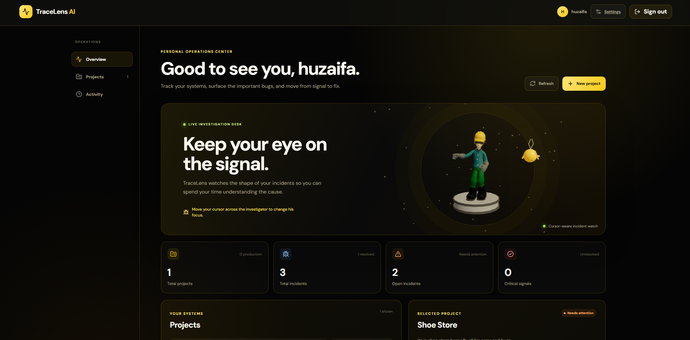

</div>

---

## ⚡ TL;DR (30 seconds)

| You do this | TraceLens does this |
|---|---|
| Paste logs / upload `.log` or `.txt` | Hides secrets, parses lines, gives each line an **Evidence ID** |
| Hit **Process logs** | Groups repeated failures into **one incident** using a **fingerprint** |
| Hit **Generate analysis** | Sends only relevant, sanitized evidence to a cloud LLM |
| Read the result | Every AI claim is **verified against real evidence**. Fake proof is rejected |
| Come back later | History, similar incidents, Word/PDF reports, admin audit trail |

> **Why not just ask a chatbot?** Because a chatbot can say *"probably a null pointer"* and never prove it. TraceLens makes the AI **cite its sources**, then the backend **checks the citations**.

| | Generic AI chat | **TraceLens AI** |
|---|:---:|:---:|
| Cites exact log lines | ❌ | ✅ |
| Backend verifies the citations | ❌ | ✅ |
| Hides secrets before AI sees them | ❌ | ✅ |
| Groups repeated errors | ❌ | ✅ |
| Remembers past incidents | ❌ | ✅ |
| Admits what it doesn't know | 😬 sometimes | ✅ `missingInformation` |
| Measured with an evaluation dataset | ❌ | ✅ |

---

## 📑 Table of Contents

1. [Product Tour 📸](#-product-tour)
2. [Features](#-features)
3. [Tech Stack](#-tech-stack)
4. [Architecture](#-architecture)
5. [Flowchart 1 — Auth, OTP & Sessions](#-flowchart-1--auth-otp--sessions)
6. [Flowchart 2 — Log → Incident → AI Diagnosis](#-flowchart-2--log--incident--ai-diagnosis)
7. [Concepts Explained Simply](#-concepts-explained-simply)
8. [Authentication Deep Dive](#-authentication-deep-dive)
9. [AI Layer](#-ai-layer)
10. [Admin Console](#-admin-console)
11. [Rate Limiting](#-rate-limiting)
12. [Security](#-security)
13. [Evaluation](#-evaluation)
14. [Data Models, API, Env, Troubleshooting](#-reference-collapsible)
15. [Project Structure](#-project-structure)
16. [Local Setup](#-local-setup)
17. [Third-Party Setup](#-third-party-setup)
18. [Deployment (Render + Netlify)](#-deployment-render--netlify)
19. [Known Limitations](#-known-limitations)
20. [Roadmap](#-roadmap)

---

## 📸 Product Tour

### 🔐 Get in
<table>
<tr>
<td width="50%">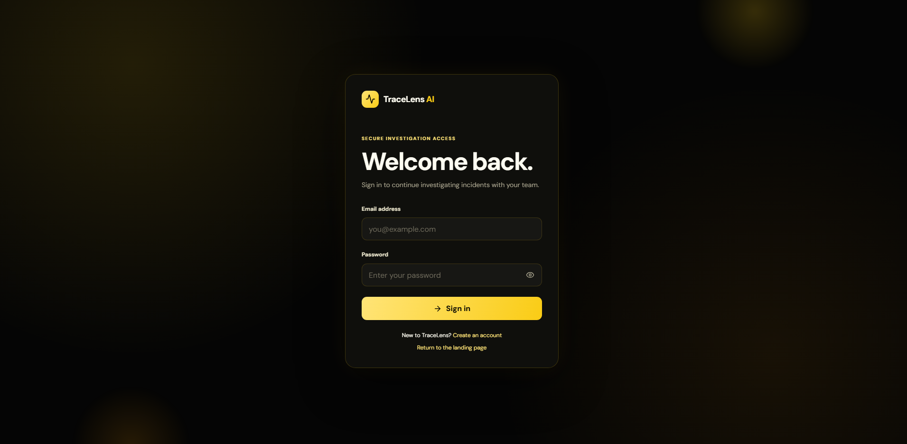<br><sub><b>Login</b> — secure investigation access. Short-lived access token + HttpOnly refresh cookie.</sub></td>
<td width="50%">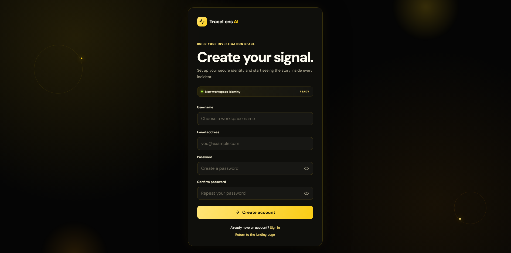<br><sub><b>Register</b> — username, email, password. Email is verified with a <b>Brevo OTP</b>.</sub></td>
</tr>
</table>

### 🕵️ Your personal operations center
<p align="center">
<br>
<sub><b>Dashboard</b> — total projects, incidents, open incidents, critical signals. Say hi to the cursor-aware 3D investigator who follows your mouse 👀</sub>
</p>

<p align="center">
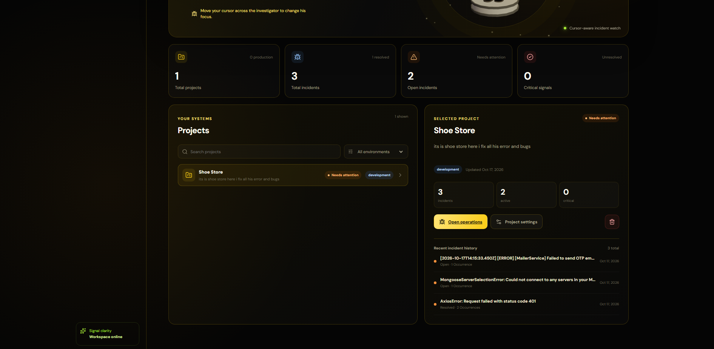<br>
<sub><b>Projects</b> — search, environment filter, selected-project focus and recent incident history.</sub>
</p>

### 🧩 Inside a project
<p align="center">
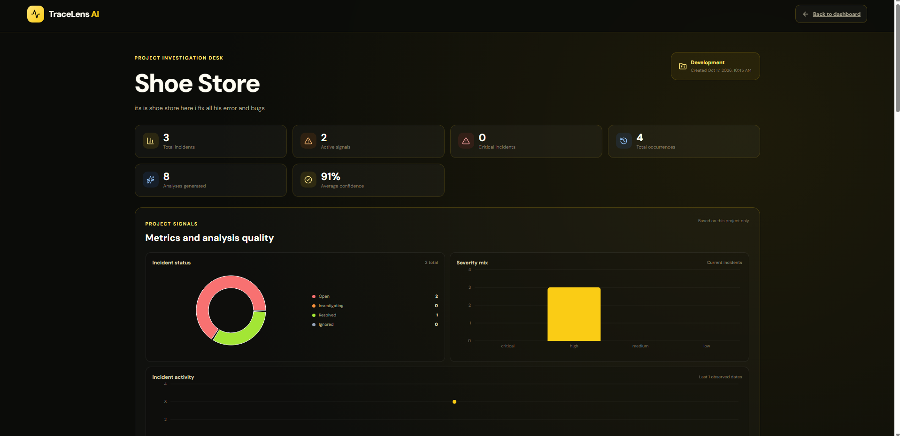<br>
<sub><b>Project investigation desk</b> — incident status donut, severity mix, activity timeline, average AI confidence.</sub>
</p>

<table>
<tr>
<td width="50%">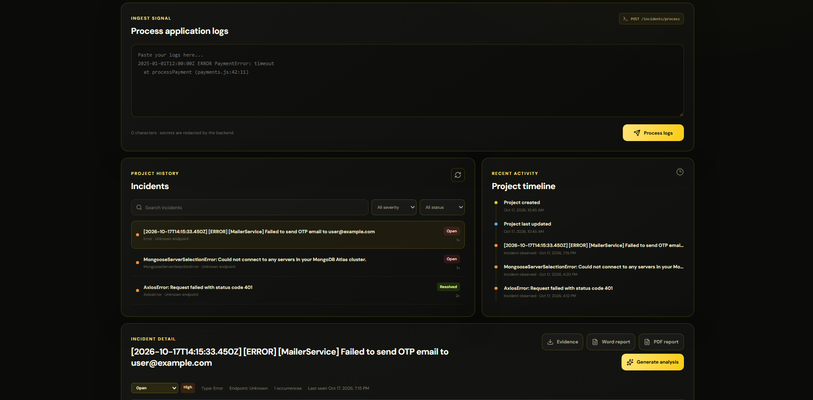<br><sub><b>Ingest</b> — paste logs, secrets are redacted by the backend. Search & filter incidents, follow the project timeline.</sub></td>
<td width="50%">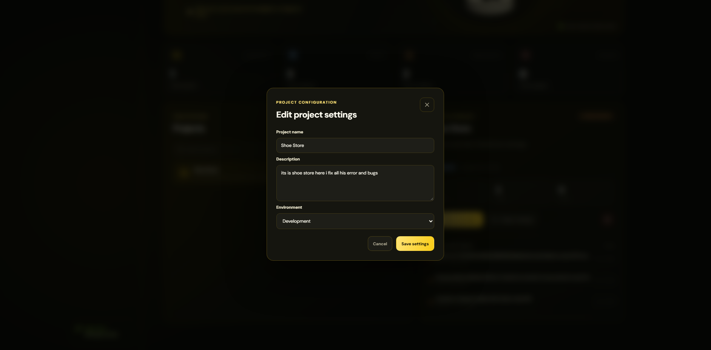<br><sub><b>Project settings</b> — name, description, environment (development / staging / production).</sub></td>
</tr>
</table>

### 🔬 The investigation
<p align="center">
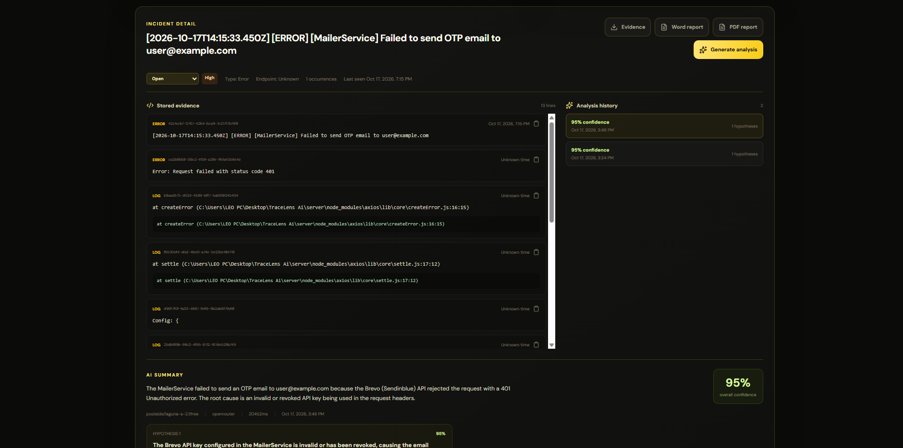<br>
<sub><b>Incident detail</b> — every stored evidence line has its own ID and a copy button. Change status, see severity, export <b>Evidence</b>, <b>Word</b> or <b>PDF</b> reports, and browse past analyses.</sub>
</p>

<p align="center">
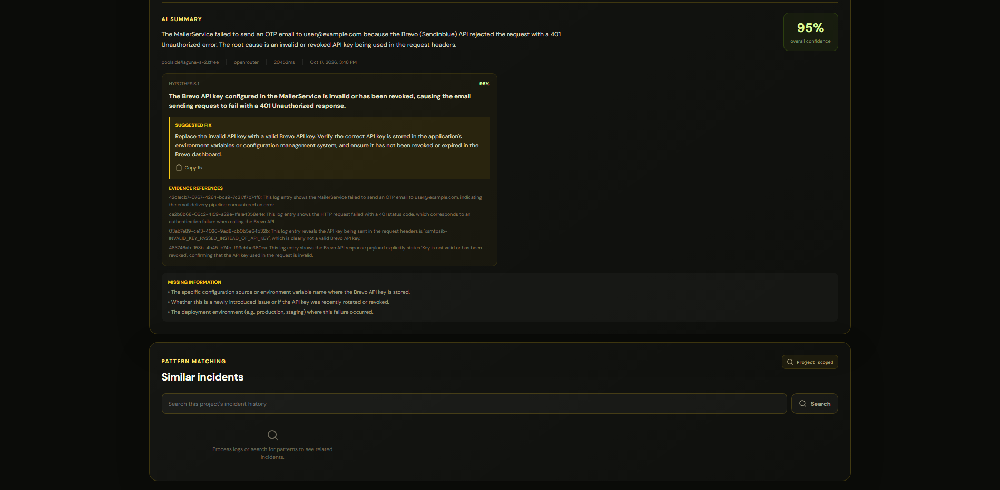<br>
<sub><b>AI analysis</b> — summary, confidence, hypotheses, suggested fix (with copy button), <b>evidence references</b> that point to real lines, honest <b>missing information</b>, and project-scoped similar-incident search.</sub>
</p>

### ⚙️ Account control
<p align="center">
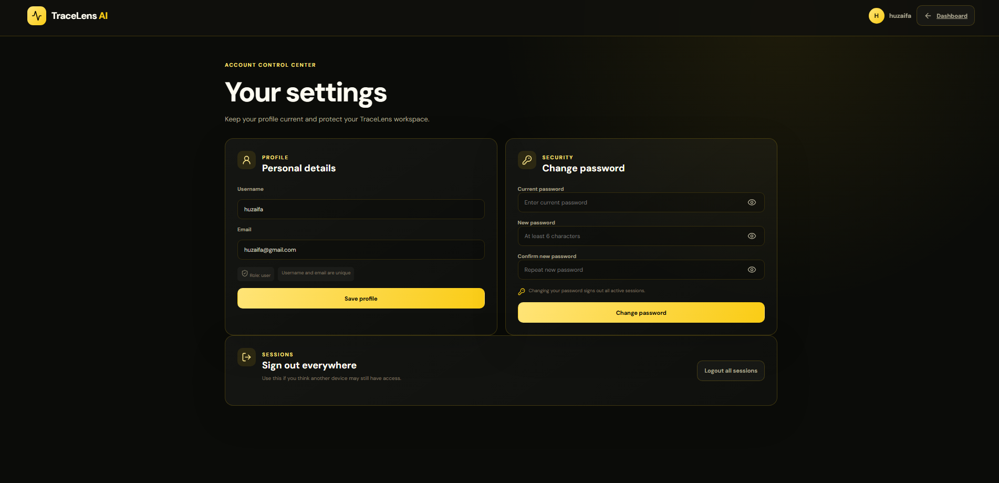<br>
<sub><b>Settings</b> — update profile, change password (signs out every session), or <b>Logout all sessions</b> if you suspect another device.</sub>
</p>

### 🛡️ Admin console
<table>
<tr>
<td width="50%">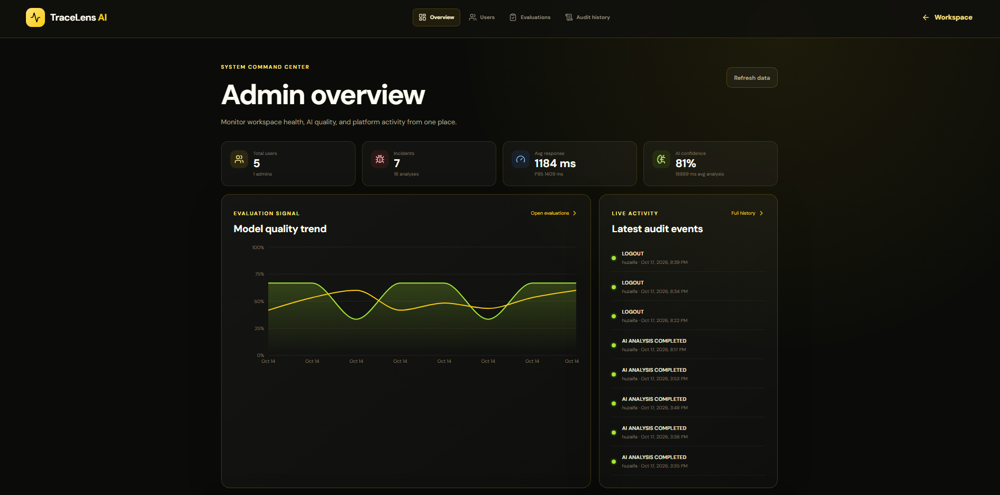<br><sub><b>Overview</b> — users, incidents, response time, AI confidence, quality trend, live audit feed.</sub></td>
<td width="50%">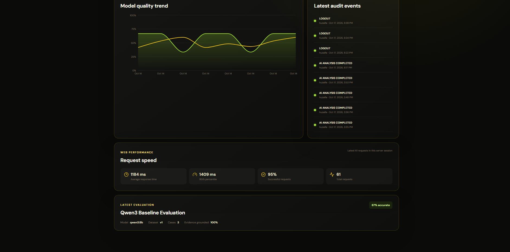<br><sub><b>Quality & speed</b> — model quality trend, request speed (avg / P95 / success rate), latest evaluation.</sub></td>
</tr>
<tr>
<td width="50%">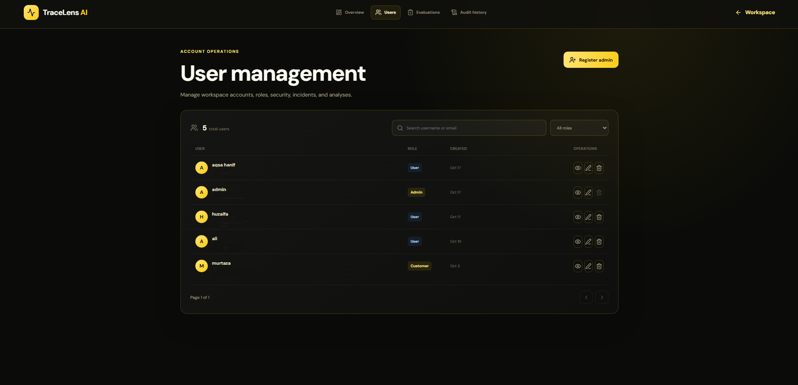<br><sub><b>User management</b> — search, role filter, view, edit, delete, register new admins.</sub></td>
<td width="50%">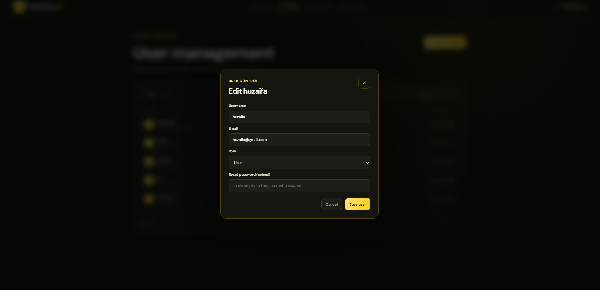<br><sub><b>Edit user</b> — change username, email, role, or reset a password.</sub></td>
</tr>
<tr>
<td width="50%">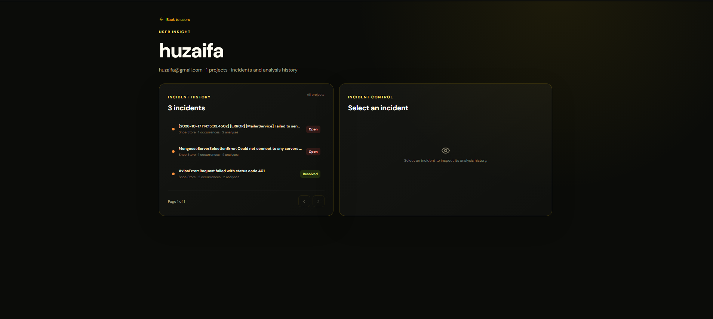<br><sub><b>User insight</b> — a user's incidents and full analysis history.</sub></td>
<td width="50%">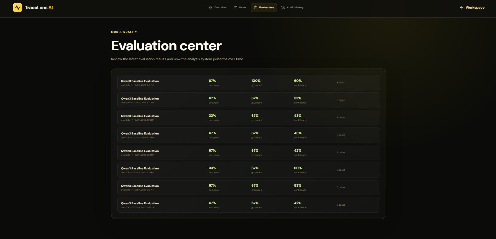<br><sub><b>Evaluation center</b> — accuracy, evidence grounding and confidence for every evaluation run.</sub></td>
</tr>
</table>

<p align="center">
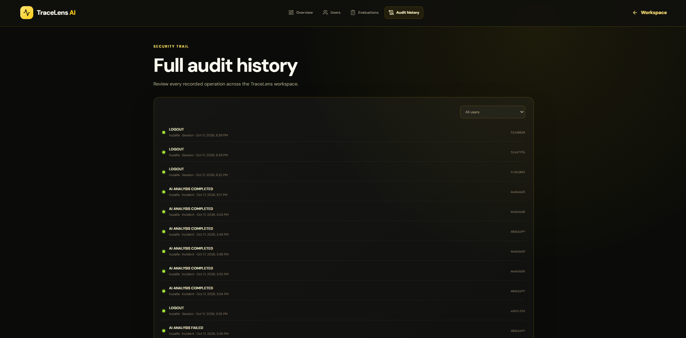<br>
<sub><b>Audit history</b> — every recorded operation (logins, logouts, AI analysis completed/failed), filterable by user.</sub>
</p>

---

## ✨ Features

| | Feature | What you get |
|---|---|---|
| 🔐 | **Secure auth** | Brevo **email OTP**, bcrypt passwords, short-lived JWT, revocable refresh sessions |
| 🧹 | **Secret redaction** | Tokens, passwords, API keys masked **before** storage and **before** AI |
| 🧾 | **Evidence IDs** | Every parsed log line gets a unique, stable ID |
| 🧬 | **Fingerprinting** | Same failure ×50 = **one** incident with `occurrenceCount = 50` |
| 🤖 | **Evidence-backed AI** | Causes, confidence, evidence, missing info, suggested fix |
| ✅ | **Evidence verification** | Backend rejects invented evidence IDs |
| 🔎 | **Similar incidents** | Semantic search with MongoDB Atlas Vector Search |
| 📄 | **Reports** | Export evidence, **Word** and **PDF** reports |
| 🕓 | **History & timeline** | Multiple analyses per incident, project timeline, activity charts |
| 🛡️ | **Roles** | `user` and `admin` with a dedicated admin console |
| 📊 | **AI evaluation** | Repeatable dataset: accuracy, grounding, confidence |
| 📈 | **Live metrics** | Avg response, P95, success rate, request count |
| 📜 | **Audit log** | Security-relevant actions recorded and searchable |
| 🚦 | **Rate limiting** | Separate limits for auth, OTP, ingestion and AI |

---

## 🧰 Tech Stack

| Layer | Technology |
|---|---|
| Frontend | React + Vite, Redux, Axios (auto-refresh interceptor) |
| Backend | Node.js + Express |
| Database | **MongoDB Atlas** + Mongoose |
| Vector search | **Atlas Vector Search** |
| AI model | **`poolside/laguna-s-2.1:free`** via **OpenRouter** |
| OTP email | **Brevo** |
| Auth | JWT access token + HttpOnly refresh cookie + `Session` collection |
| Hosting | **Netlify** (frontend) · **Render** (backend) |
| Testing | Jest + Supertest |

> 📝 **SRS note:** the original SRS used Ollama (local) + Hugging Face ZeroGPU. This build uses **one cloud LLM** instead. Everything else follows the SRS, and because AI access sits behind an adapter, no business logic changed.

---

## 🏗 Architecture

```
                 ┌──────────────────────────────┐
                 │   React + Vite  (Netlify)    │
                 │ User workspace · Admin panel │
                 └──────────────┬───────────────┘
                                │ HTTPS · REST · HttpOnly cookie
                                ▼
                 ┌──────────────────────────────┐
                 │   Node + Express  (Render)   │
                 │ Rate limit → Auth → Validate │
                 │ Routes → Services            │
                 └──┬───────────┬────────────┬──┘
                    │           │            │
          ┌─────────▼──┐  ┌─────▼─────┐  ┌───▼───────────────┐
          │ MongoDB    │  │  Brevo    │  │ AI service        │
          │ Atlas      │  │ OTP mails │  │ OpenRouter →      │
          │ + Vectors  │  └───────────┘  │ laguna-s-2.1:free │
          └────────────┘                 └───────────────────┘
```

**Principles:** frontend/backend are separate apps · routes stay thin, **services hold logic** · AI sits behind an adapter · **AI output is never trusted blindly** · AI failures never corrupt incidents.

---

## 🔑 Flowchart 1 — Auth, OTP & Sessions

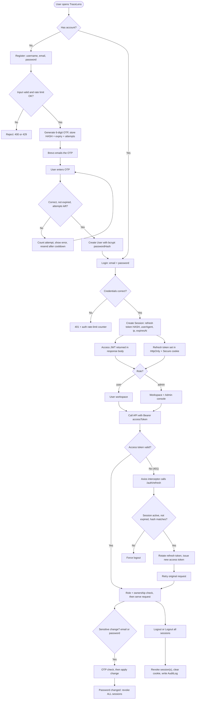

**Easy version:** register → code arrives by email → account created. Login gives a **short access token** (kept in memory) and a **long refresh token** (hidden in an HttpOnly cookie JavaScript can't read). When the access token expires the app silently refreshes it. Logout marks the session revoked, so even a stolen refresh token stops working.

---

## 🧠 Flowchart 2 — Log → Incident → AI Diagnosis

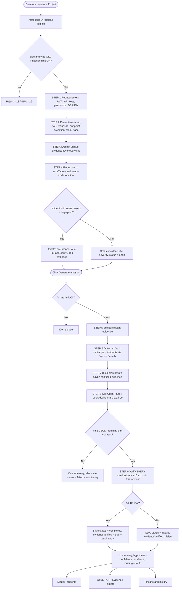

**Easy version:** the **left half** (steps 1–4) is plain code that prepares evidence. The **right half** (steps 5–9) asks the AI, then **checks the AI**.

---

## 📘 Concepts Explained Simply

<details>
<summary><b>🧹 Secret redaction</b></summary>

```
Before: Authorization: Bearer abc123secret
After : Authorization: Bearer [REDACTED]
```
Covers JWTs, bearer tokens, API keys, `password=` fields and credentials inside connection strings.
</details>

<details>
<summary><b>🧾 Parsing & Evidence IDs</b></summary>

Parsing turns raw text into fields: `level`, `endpoint`, `errorType`, `requestId`, `stackTrace`, `timestamp`.

Every line then receives a **unique evidence ID** (shown in the UI as a UUID such as `42c1ecb7-0767-…`). The AI must cite these IDs, they are the "proof numbers".
</details>

<details>
<summary><b>🧬 Fingerprint vs Evidence ID</b></summary>

- **Fingerprint** = identity of the **whole problem** (`TypeError + POST /api/cart + cartController.js:42`).
- **Evidence ID** = identity of **one log line**.

Same fingerprint again → the existing incident is updated instead of creating a duplicate.
</details>

<details>
<summary><b>📂 Incident</b></summary>

One record per unique failure (`project + fingerprint`) with `severity` (low → critical), `status` (open → investigating → resolved / ignored), `firstSeenAt`, `lastSeenAt`, `occurrenceCount` and all evidence lines.
</details>

<details>
<summary><b>🤖 Analysis, confidence & missing information</b></summary>

```json
{
  "summary": "addToCart accesses an undefined value on POST /api/cart",
  "hypotheses": [{
    "cause": "req.body.item is undefined when addToCart runs",
    "confidence": 0.88,
    "evidence": [
      { "sourceLineId": "42c1ecb7-…", "explanation": "TypeError on undefined property" }
    ],
    "suggestedFix": "Validate the request body before using item."
  }],
  "missingInformation": ["Actual request payload"],
  "overallConfidence": 0.85
}
```
`confidence` is the AI's own estimate, **not** a guaranteed probability. `missingInformation` lists what would improve the diagnosis.
</details>

<details>
<summary><b>✅ Evidence verification (the key idea)</b></summary>

If the AI cites an ID that does not exist in that incident, the analysis is saved as **`invalid`** with `evidenceVerified = false` and is **never shown as verified proof**.
</details>

<details>
<summary><b>🔎 Embeddings & similar incidents</b></summary>

Text becomes a vector. Incidents with similar *meaning* get similar vectors, even if worded differently ("Mongo connection timeout" ≈ "Database connection timed out"). Atlas Vector Search finds them, scoped to the same user/project.
</details>

---

## 🔐 Authentication Deep Dive

| Part | Lifetime | Stored in | Purpose |
|---|---|---|---|
| **Access JWT** | short (e.g. 15 min) | memory (never localStorage) | authorize API calls |
| **Refresh token** | long (e.g. 7 days) | **HttpOnly + Secure cookie** | get new access tokens |
| **Session document** | until expiry / revoke | MongoDB | server-side control & revocation |

**OTP rules (defaults, configurable via env)**

| Rule | Default |
|---|---|
| Length | 6 digits |
| Validity | 10 minutes |
| Wrong attempts | 5, then OTP is invalidated |
| Resend cooldown | 60 seconds |
| Storage | **hashed**, never plain text |
| Use | single-use, deleted on success |

**Refresh with rotation:** read cookie → hash it → find an **active, unexpired** session with the same hash → issue a new access token **and** a new refresh token (the old one dies).

**Settings page behaviour:** changing the password requires the current password and **signs out all active sessions**. *Logout all sessions* revokes every session of the account.

**Authorization:** every request checks the **role** (`user` / `admin`) and **ownership**. User IDs sent by the frontend are never trusted.

---

## 🤖 AI Layer

| Item | Value |
|---|---|
| Model | `poolside/laguna-s-2.1:free` |
| Provider | **OpenRouter** (OpenAI-compatible API) |
| Stored per analysis | model name, runtime (`openrouter`), duration, timestamp |

**Rules for the model:** analyze only supplied sanitized evidence · never invent an evidence ID · say so in `missingInformation` when evidence is thin · never claim a fix was applied · never reproduce secrets.

**Safety net in code:** JSON schema validation → evidence verification → one safe retry → otherwise save as `failed`. Success and failure are both written to the audit log.

---

## 🛡 Admin Console

| Page | What admins can do |
|---|---|
| **Overview** | Users, incidents, avg response, AI confidence, quality trend, latest audit events, request speed (avg / P95 / success rate) |
| **Users** | Search, filter by role, view, edit, reset password, delete, **register new admins** |
| **User insight** | See any user's incidents and full analysis history |
| **Evaluations** | Review every evaluation run: accuracy, grounding, confidence |
| **Audit history** | Full operation trail with per-user filter |

> Request-speed metrics are kept in memory for the current server session, so they reset when the server restarts.

---

## 🚦 Rate Limiting

Built with `express-rate-limit`. Exceeding a limit returns **`429 Too Many Requests`**.

| Limiter | Applies to | Default |
|---|---|---|
| Global | all `/api` routes | 100 req / 15 min |
| Auth | login, register, refresh | 10 req / 15 min |
| OTP | send / resend / verify | 5 req / 15 min + 60 s cooldown |
| Ingestion | log processing | 20 req / 15 min |
| AI analysis | generate analysis | `AI_RATE_LIMIT` (e.g. 10 / hour) |

On Render set `app.set('trust proxy', 1)` so limits use the **real client IP**.

---

## 🔒 Security

- bcrypt password hashing · OTPs and refresh tokens stored **hashed**
- HttpOnly + Secure + SameSite refresh cookie · short-lived access tokens
- Session revocation (logout, logout-all, password change)
- Secret redaction before DB storage **and** before AI calls
- Role + ownership checks on every resource
- Input validation (IDs, enums, strings, file types, sizes)
- Strict CORS allow-list with credentials · Helmet headers
- Rate limiting on auth, OTP, ingestion, AI
- Audit logging · uploads limited to `.log` / `.txt`
- `.env` never committed

---

## 📊 Evaluation

TraceLens measures its own AI instead of just claiming it works.

| Metric | Meaning |
|---|---|
| Root-cause accuracy | predicted cause matches expected keywords |
| Evidence grounded | cited IDs exist and support the claim |
| Confidence | mean AI-estimated confidence |

Dataset **v2** has **16 synthetic incidents** from easy to hard: DB timeouts, missing routes, null access, bad JWT config, duplicate keys, CORS, out-of-memory, noisy logs with red herrings, cascading failures and an **insufficient-evidence** case that tests honesty.

```bash
cd server/src
node scripts/runEvaluation.js
```

Results appear in the admin **Evaluation center** (see the tour above).

> These numbers come from a small synthetic dataset. They show engineering discipline around AI quality, **not** scientific model accuracy.

---

## 📚 Reference (collapsible)

<details>
<summary><b>🗄 Data models</b></summary>

| Model | Purpose | Key fields |
|---|---|---|
| **User** | Account | `username`, `email` (unique), `passwordHash`, `role` |
| **Session** | Login session | `user`, `refreshTokenHash`, `userAgent`, `ip`, `expiresAt`, `revokedAt`, `lastUsedAt` |
| **Project** | Workspace | `owner`, `name`, `description`, `environment` |
| **Incident** | A unique failure | `project`, `fingerprint`, `title`, `severity`, `status`, `endpoint`, `errorType`, `firstSeenAt`, `lastSeenAt`, `occurrenceCount`, `logs[]`, `embedding` |
| **Analysis** | One AI run | `incident`, `modelName`, `runtime`, `summary`, `hypotheses[]`, `missingInformation[]`, `evidenceVerified`, `status`, `durationMs` |
| **EvaluationRun** | Quality test | `datasetVersion`, `totalCases`, `correctRootCauseCount`, `evidenceGroundedCount`, `averageConfidence`, `results[]` |
| **AuditLog** | Action history | `user`, `action`, `resourceType`, `resourceId`, `metadata` |

Indexes: `User.email` (unique) · `Session.user + expiresAt` · `Project.owner + createdAt` · `Incident.project + fingerprint` · `Incident.project + status + lastSeenAt` · `Analysis.incident + createdAt` · Atlas **vector index** on `Incident.embedding`. OTP records auto-expire via a TTL index.
</details>

<details>
<summary><b>🌐 REST API (original 25 endpoints)</b></summary>

🔒 = requires `Authorization: Bearer <accessToken>`

| # | Method | Endpoint | Purpose |
|---|---|---|---|
| 1 | POST | `/auth/register` | Start registration, send OTP |
| 2 | POST | `/auth/login` | Login, create session |
| 3 | POST | `/auth/refresh` | Rotate refresh token |
| 4 | POST | `/auth/logout` | Revoke session |
| 5 | GET | `/auth/me` 🔒 | Current user |
| 6 | POST | `/projects` 🔒 | Create project |
| 7 | GET | `/projects` 🔒 | List my projects |
| 8 | GET | `/projects/:projectId` 🔒 | Get project |
| 9 | PATCH | `/projects/:projectId` 🔒 | Update project |
| 10 | DELETE | `/projects/:projectId` 🔒 | Delete project |
| 11 | POST | `/projects/:projectId/logs` 🔒 | Ingest logs → incident |
| 12 | GET | `/projects/:projectId/incidents` 🔒 | List incidents |
| 13 | GET | `/incidents/:incidentId` 🔒 | Incident + evidence |
| 14 | PATCH | `/incidents/:incidentId/status` 🔒 | Change status |
| 15 | DELETE | `/incidents/:incidentId` 🔒 | Delete incident |
| 16 | POST | `/incidents/:incidentId/analyze` 🔒 | Run AI analysis |
| 17 | GET | `/incidents/:incidentId/analyses` 🔒 | List analyses |
| 18 | GET | `/analyses/:analysisId` 🔒 | One analysis |
| 19 | GET | `/incidents/:incidentId/similar` 🔒 | Similar incidents |
| 20 | POST | `/analyses/:analysisId/regression-test` 🔒 | Regression-test draft |
| 21 | GET | `/projects/:projectId/stats` 🔒 | Project stats |
| 22 | POST | `/evaluations/run` 🔒 | Run evaluation |
| 23 | GET | `/evaluations/:evaluationId` 🔒 | Evaluation result |
| 24 | GET | `/health` | Liveness |
| 25 | GET | `/ready` | Readiness |

Extras in this build: OTP verify/resend, admin user management, audit-history listing, request metrics, and evidence / Word / PDF report export. Route names follow the files in `src/routes/`.
</details>

<details>
<summary><b>🔧 Environment variables</b></summary>

**Server (`server/src/.env`)**
```dotenv
NODE_ENV=development
PORT=5000
CLIENT_URL=http://localhost:5173

MONGO_URI=mongodb+srv://<user>:<password>@<cluster>.mongodb.net/tracelens

JWT_ACCESS_SECRET=<long-random-string>
JWT_ACCESS_EXPIRES=15m
REFRESH_TOKEN_SECRET=<different-long-random-string>
REFRESH_TOKEN_EXPIRES=7d

LLM_BASE_URL=https://openrouter.ai/api/v1
LLM_API_KEY=<your-openrouter-key>
LLM_MODEL=poolside/laguna-s-2.1:free

BREVO_API_KEY=<your-brevo-key>
BREVO_SENDER_EMAIL=<verified-sender@yourdomain.com>
BREVO_SENDER_NAME=TraceLens AI
OTP_EXPIRES_MINUTES=10
OTP_MAX_ATTEMPTS=5

LOG_MAX_SIZE=2mb
AI_RATE_LIMIT=10
```

**Client (`client/.env`)**
```dotenv
VITE_API_URL=http://localhost:5000/api
```
⚠️ Never commit `.env`. Commit a `.env.example` with empty values instead.
</details>

<details>
<summary><b>🩺 Troubleshooting</b></summary>

| Problem | Likely cause | Fix |
|---|---|---|
| `injected env (0)` / `uri undefined` | `.env` not found from the folder you ran node in | Load it with `dotenv.config({ path: path.resolve(__dirname, "../.env") })` |
| CORS error | `CLIENT_URL` mismatch | exact Netlify URL, no trailing `/`, `credentials: true` |
| Refresh cookie not saved | missing `SameSite=None; Secure` or `withCredentials` | apply the deployment cookie settings below |
| OTP mail not arriving | sender not verified / spam | verify sender in Brevo, check spam |
| Brevo `401` in logs | invalid or revoked API key | regenerate the key and update `BREVO_API_KEY` |
| `429` too early | shared proxy IP | `app.set('trust proxy', 1)` |
| Mongo error on Render | Atlas IP allow-list | allow `0.0.0.0/0` |
| Vector search empty | missing index / wrong dimensions | recreate index with matching `numDimensions` |
| Analysis `invalid` | AI cited a non-existent evidence ID | expected safety behaviour, re-run |
| Analysis `failed` | LLM quota / timeout / bad JSON | retry later, check key and model name |
| Netlify 404 on refresh | missing `_redirects` | add the SPA redirect file |
</details>

---

## 🗂 Project Structure

```
tracelens-ai/
├── client/                         # React + Vite  → Netlify
│   ├── public/_redirects
│   └── src/ (pages, components, features, services/api.js)
├── server/
│   └── src/                        # Backend root (package.json lives here)
│       ├── config/                 # databaseConfig.js ...
│       ├── models/                 # User, Session, Project, Incident, Analysis, EvaluationRun, AuditLog
│       ├── routes/                 # auth, user, admin, project, incident, analysis, evaluation, auditLog
│       ├── service/                # ai, analysis, auditLog, embedding, incidentFingerprint,
│       │                           # incidentProcessing, incidentSearch, logParser, logRedaction,
│       │                           # metrics, project
│       ├── evaluation/             # incidentDataset.js (v2, 16 cases)
│       ├── scripts/                # runEvaluation.js, testEmbedding.js
│       ├── test/                   # log-processing.test.js
│       ├── utils/
│       ├── app.js
│       └── server.js
└── docs/screenshots/               # images used in this README
```

---

## 💻 Local Setup

**Prerequisites:** Node.js 18+, a MongoDB Atlas cluster, a Brevo account, an OpenRouter API key.

```bash
git clone https://github.com/<your-username>/tracelens-ai.git
cd tracelens-ai

# Backend
cd server/src
npm install
cp .env.example .env     # fill in values
npm run dev              # http://localhost:5000

# Frontend (new terminal)
cd client
npm install
cp .env.example .env
npm run dev              # http://localhost:5173
```

**Try it:** register → enter the emailed OTP → login → create a project → paste this → **Generate analysis**

```
2026-10-17T10:15:02Z ERROR POST /api/cart 500
TypeError: Cannot read properties of undefined (reading 'item')
    at addToCart (cartController.js:42)
```

---

## 🔌 Third-Party Setup

<details>
<summary><b>MongoDB Atlas + Vector index</b></summary>

1. Create a free cluster and a database user.
2. Network Access: your IP locally, `0.0.0.0/0` for Render (free-tier IPs are not fixed).
3. Put the connection string in `MONGO_URI`.
4. Create a Vector Search index on `incidents`:

```json
{
  "fields": [
    { "type": "vector", "path": "embedding", "numDimensions": 384, "similarity": "cosine" },
    { "type": "filter", "path": "project" }
  ]
}
```
`numDimensions` must equal your embedding model's output size.
</details>

<details>
<summary><b>Brevo (OTP emails)</b></summary>

1. **SMTP & API → API Keys** → generate a key → `BREVO_API_KEY`.
2. **Senders & IP** → add and **verify** a sender → `BREVO_SENDER_EMAIL`.
3. Optional but recommended: authenticate your domain (SPF / DKIM).
4. The free plan has a daily send limit, fine for a demo.
</details>

<details>
<summary><b>OpenRouter (AI)</b></summary>

1. Create an API key at OpenRouter.
2. Set `LLM_BASE_URL`, `LLM_API_KEY`, `LLM_MODEL=poolside/laguna-s-2.1:free`.
3. Test with a tiny prompt before running a full analysis.
</details>

---

## 🚀 Deployment (Render + Netlify)

### Backend → Render
| Setting | Value |
|---|---|
| Root Directory | `server/src` |
| Build Command | `npm install` |
| Start Command | `npm start` |
| Health Check Path | `/api/health` |

Add every server env var and set `NODE_ENV=production` and `CLIENT_URL=https://<your-app>.netlify.app` (no trailing slash).

**Cross-domain cookie settings** (Netlify and Render are different domains):

```js
app.set('trust proxy', 1);
app.use(cors({ origin: process.env.CLIENT_URL, credentials: true }));

res.cookie('refreshToken', token, {
  httpOnly: true,
  secure: true,
  sameSite: 'none',
  maxAge: 7 * 24 * 60 * 60 * 1000,
});
```
Axios: `withCredentials: true`.

### Frontend → Netlify
| Setting | Value |
|---|---|
| Base directory | `client` |
| Build command | `npm run build` |
| Publish directory | `client/dist` |
| Env | `VITE_API_URL=https://<your-api>.onrender.com/api` |

Add `client/public/_redirects`:
```
/*    /index.html   200
```
Then copy the Netlify URL into Render's `CLIENT_URL` and redeploy the backend.

### ✅ Post-deploy checklist
- [ ] `/api/health` and `/api/ready` respond
- [ ] Register → OTP email arrives
- [ ] Login sets the refresh cookie
- [ ] Refresh works after the access token expires
- [ ] Logout / Logout all sessions revoke access
- [ ] Log processing creates an incident
- [ ] AI analysis returns `evidenceVerified: true`
- [ ] Rate limit returns `429` when exceeded
- [ ] Admin console visible only to admins
- [ ] No secrets in the repo or frontend bundle

---

## ⚠️ Known Limitations

- The `:free` model tier has provider-side rate limits and variable latency (analysis can take ~20 s).
- Render's free tier sleeps when idle, so the first request can take 30–60 s.
- AI confidence is an **estimate**, not a calibrated probability.
- AI **suggests**, it never changes or deploys code.
- Logs come from paste / upload only (no live log agent in v1).
- Brevo's free plan limits daily OTP emails.

---

## 🗺 Roadmap

- [x] OTP-verified auth with revocable sessions
- [x] Evidence-verified AI diagnosis
- [x] Admin console, audit history, evaluation center
- [x] Word / PDF / evidence export
- [ ] Live log agent / SDK
- [ ] Background queue for AI jobs
- [ ] Team workspaces and shared projects
- [ ] Slack / email alerts for critical incidents

---

<div align="center">

### Redact → Parse → Evidence → Fingerprint → Incident → AI → **Verify** → Learn

If TraceLens saved you from a 3 AM log hunt, drop a ⭐

Built with ☕ and way too many stack traces by **[Syed Muneeb](https://github.com/SyedMuneeb40)**

</div>
